# RoomFit

**스캔 한 번으로 시작하는, 내 방에서 미리 확인하는 가구 배치**

RoomFit은 iPhone으로 스캔한 내 방과 실제 판매 가구 193종의 치수를 연결해, 구매 전에 배치안을 3D로 비교·편집·검증하는 서비스입니다.
가구 배치는 엔진이 계산·검증하고, LLM은 사용자 요구를 조건으로 분해합니다.

🔗 **Service** — [roomfit-khu.kro.kr](https://roomfit-khu.kro.kr/)

<p align="center">
  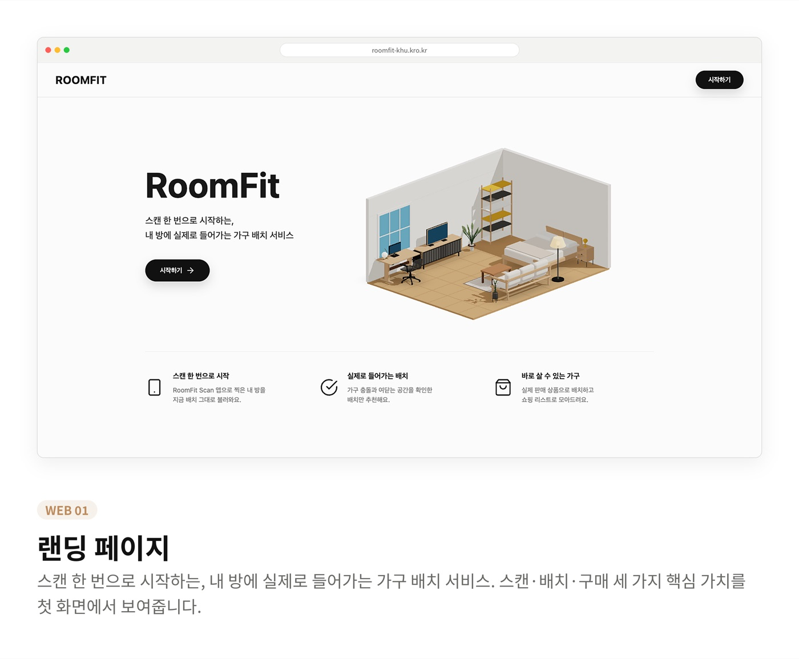
</p>

## 🏆 Awards

| Date | Competition | Award |
|:---|:---|:---|
| 2026.11 | [SW중심대학 연합 AI·SW Festival](https://swedu.khu.ac.kr/bbs/board.php?bo_table=07_01&wr_id=2610) | 🥈 최우수상 |
| 2026.08 | [SW중심대학 Digital Competition (SW Division)](https://dacon.io/competitions/official/236693/overview/description) | 🥉 우수상 & 🏅 인기상 |

## Why RoomFit

1인 가구 804만(2024년, 전체의 36.1%), 그중 절반은 40㎡ 이하 주택에 삽니다. 작은 방일수록 가구 배치가 어렵습니다.

| 문제 | 기존 방식 | RoomFit |
|:---|:---|:---|
| **공간 준비** | 방·문·창문 치수를 줄자로 재고 도면으로 옮김 | 앱으로 스캔하고 웹에서 치수 보정 |
| **배치 구성** | 상품을 직접 찾아 치수를 하나씩 대조 | 실제 상품으로 추천받고 3D에서 직접 편집 |
| **최종 판단** | 문 열림·통로·판매처를 각각 확인 | 충돌·개폐·통로 근사 검사 + 실제 상품 페이지 연결 |

측정 → 탐색 → 배치 → 수정의 반복을, **스캔한 내 방 하나에서** 끝냅니다.

## How it works

### 1. 방 스캔 & 업로드 — RoomFit Scan (iOS)

Apple RoomPlan으로 방을 스캔해 서버에 올리고, 연결 코드 한 번으로 웹 작업실과 이어집니다.

<p align="center">
  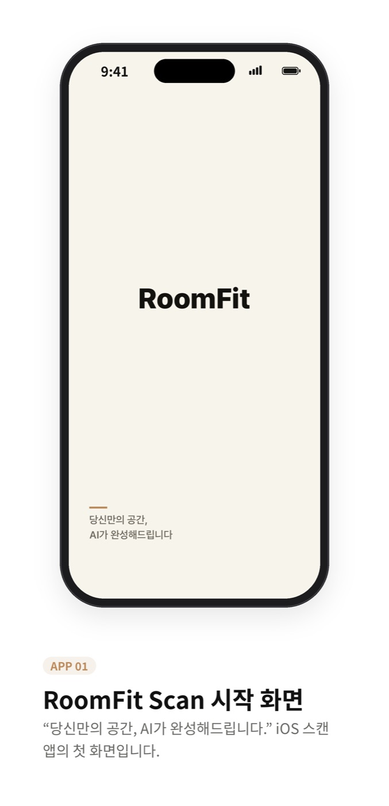
  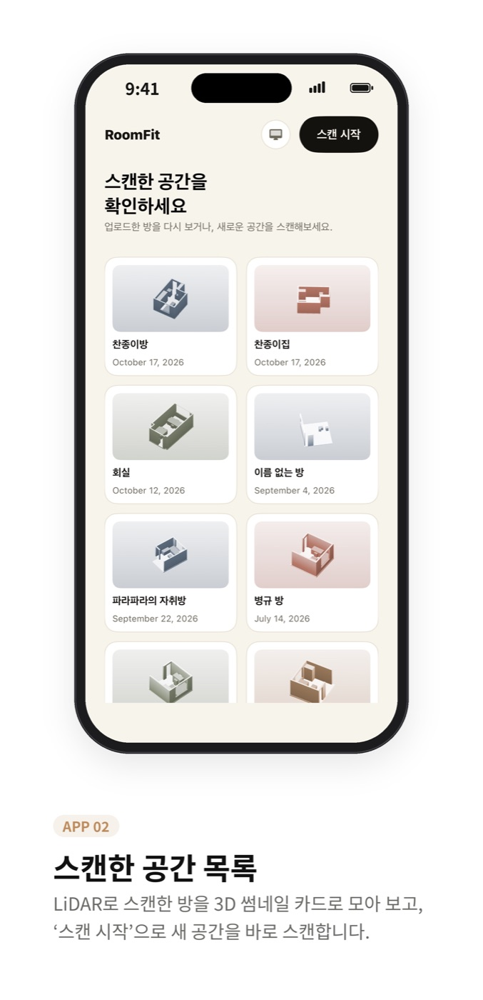
  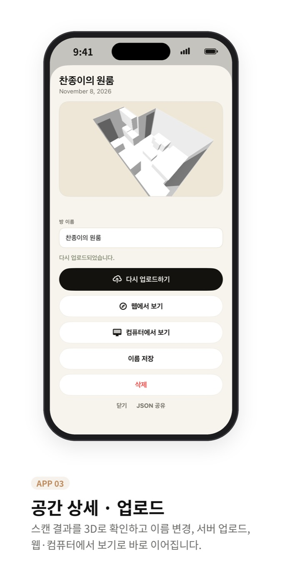
  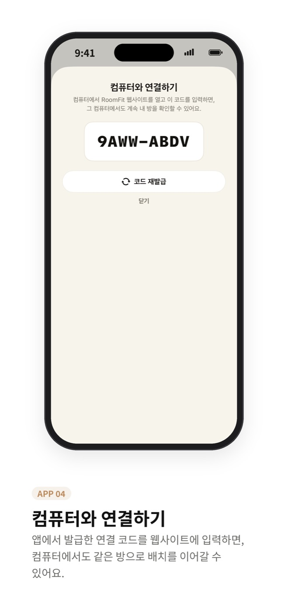
</p>

<p align="center">
  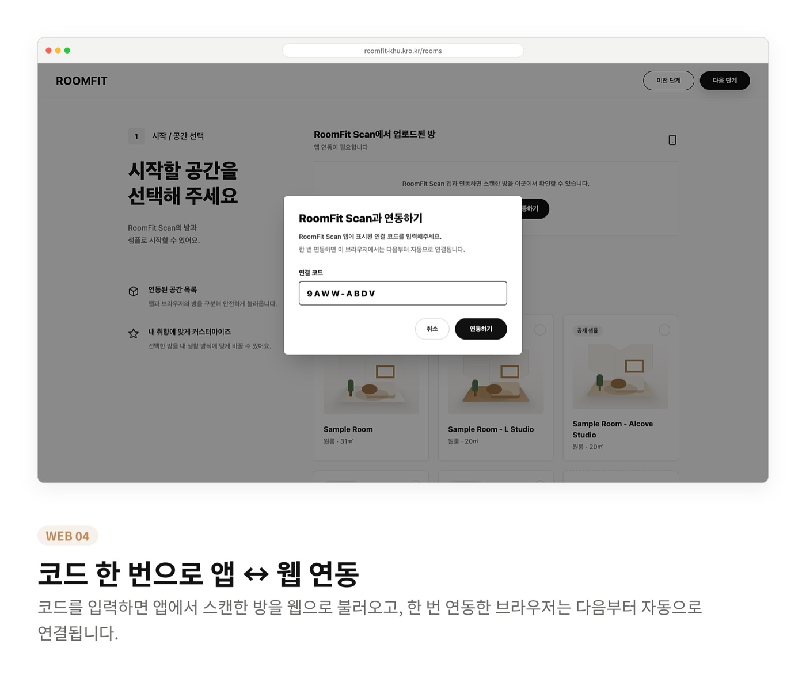
  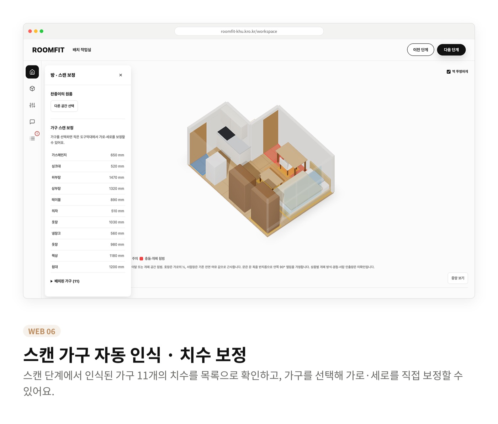
</p>
<p align="center"><sub>연결 코드로 앱–웹 연동 · 스캔 가구 자동 인식과 치수 보정</sub></p>

### 2. 실제 상품 탐색 & 취향 선택

<p align="center">
  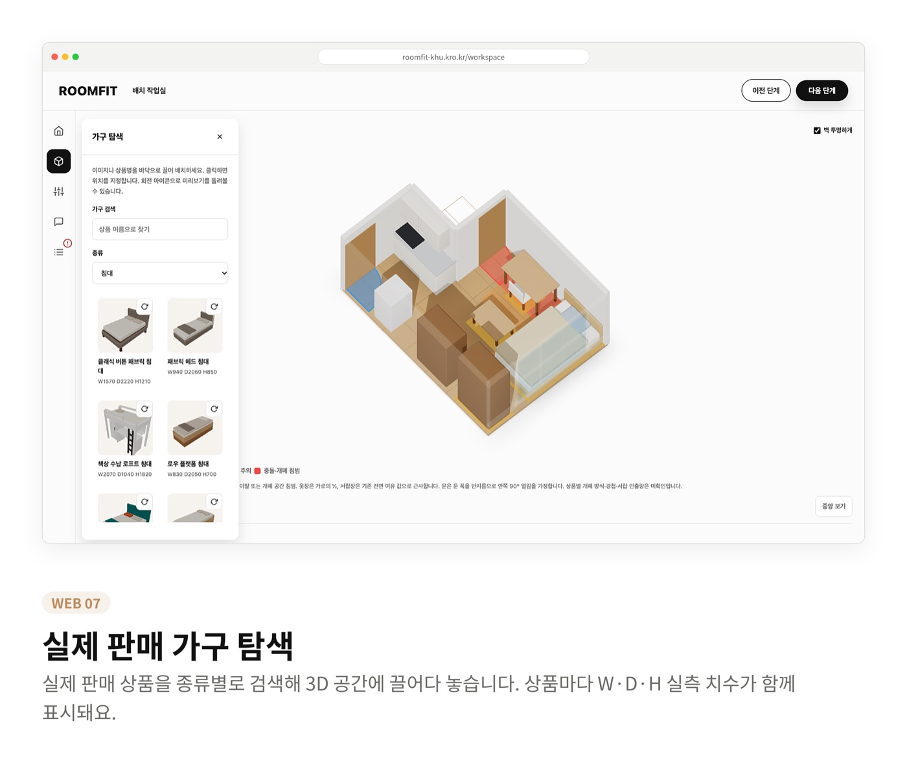
  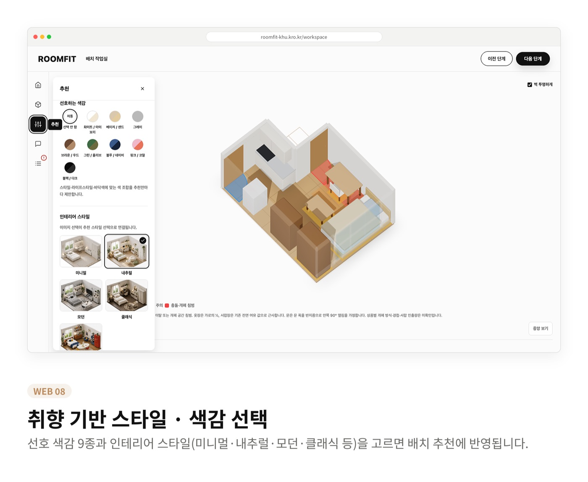
</p>
<p align="center"><sub>실제 판매 가구 탐색 · 취향 기반 스타일·색감 선택</sub></p>

### 3. 배치 추천 비교 & 직접 편집

실측 상품 치수로 서로 다른 추천안을 **최대 3개** 만들고, 위치·방향·크기를 3D에서 직접 고칠 수 있습니다.

<p align="center">
  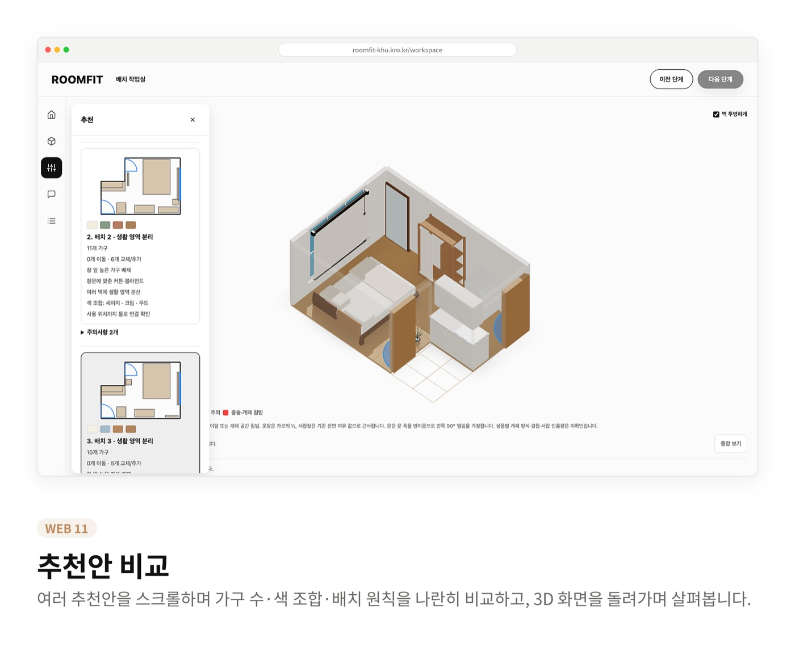
  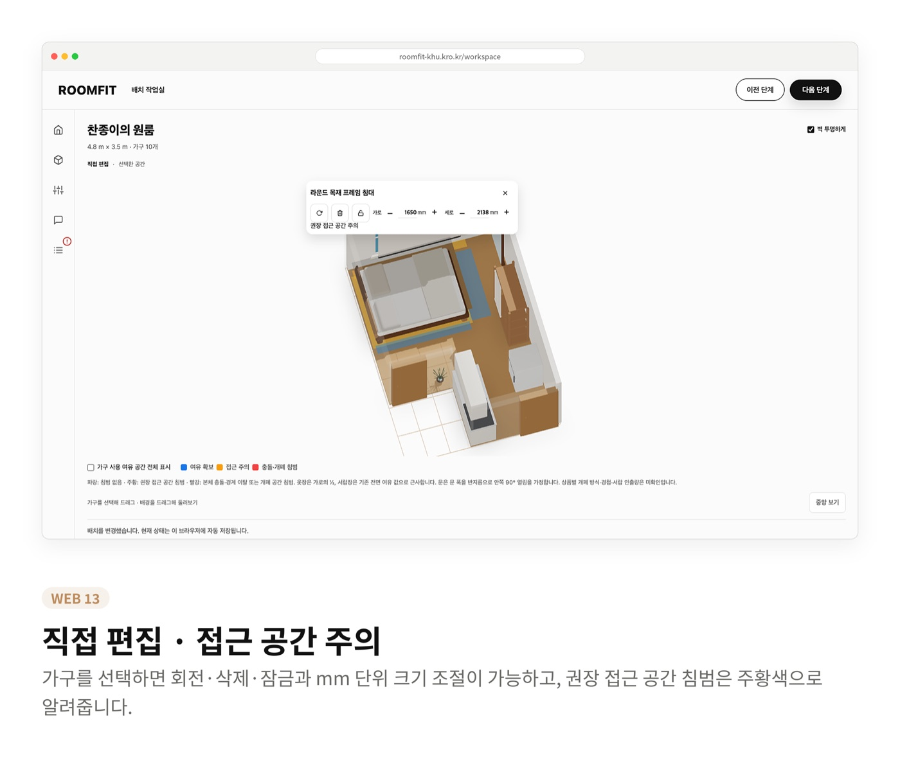
</p>
<p align="center"><sub>추천안 비교 · 직접 편집과 접근 공간 주의</sub></p>

### 4. 충돌·개폐 검증 & 구매 연결

가구 충돌, 문·수납 개폐 공간, 통로를 색상과 검증 리포트로 확인하고, 확정한 배치의 상품 판매처로 바로 이동합니다.

<p align="center">
  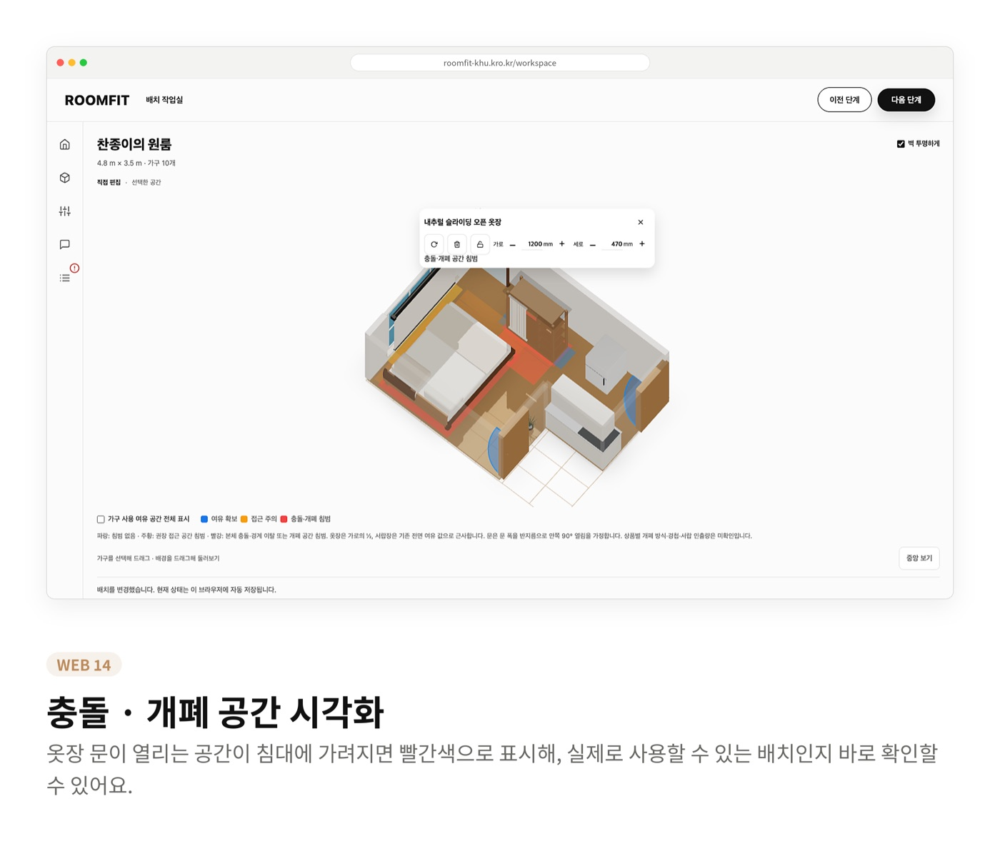
  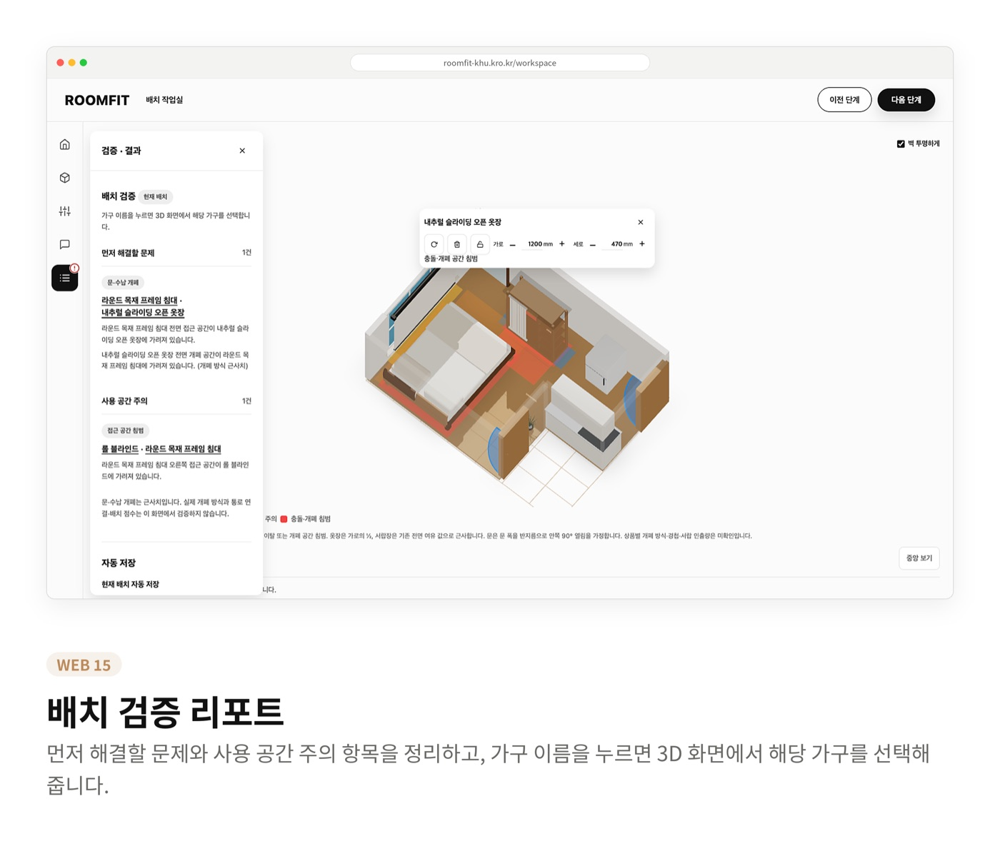
</p>
<p align="center"><sub>충돌·개폐 공간 시각화 · 배치 검증 리포트</sub></p>

## Core Technology

### LLM 조건 분해 → 사용자 확인 → 배치 엔진

```text
"책상하고 책장도 필요해. 옷은 없어서 옷장은 필요 없어"
        │
        ▼
   LLM (OpenAI)          수량·제외·유지·취향 조건으로 분해 + 해석 근거
        │  조건 JSON
        ▼
   사용자 확인            해석을 수정하고 포함·필수 여부 확정
        │
        ▼
   배치 엔진 (Web Worker)  상품·위치 계산, 충돌·개폐·통로 검사
        │
        ▼
   책상 1개 · 책장 1개 · 옷장 제외가 반영된 추천안 3개
```

LLM은 배치를 직접 만들지 않습니다. 자연어 요구를 구조화된 조건으로 바꾸는 역할만 하고, 사용자가 확인한 조건으로 엔진이 배치를 계산합니다.

### 배치 엔진 — 빔 탐색

```text
방 구조 · 193종 상품 치수 · 확인한 조건 (고정설비·잠금 가구는 보존)
  └─▶ 가구 1개 추가 (상품·위치·방향 후보 확장)
        └─▶ 공간 제약 통과? ── 실패 → 후보 제외
              └─ 통과 → 취향·공간 관계로 평가, 단계마다 상위 8개 유지
                    └─▶ 추가할 가구가 남았으면 반복
                          └─▶ 최종 검증 · 다양성 선별 → 추천안 최대 3개
```

- **제약 검사**: 가구 본체 충돌과 방 경계, 문·수납 개폐 여유, 사용 위치까지 이어지는 60cm 통로, 커튼·파티션 설치 규칙
- **재탐색**: 공간이 부족하면 작은 가구·축소된 자동 구성으로 다시 탐색하되, 필수·제외·잠금 조건은 유지
- **실패를 꾸미지 않음**: 물리적으로 불가능한 필수 조건은 성공한 배치로 포장하지 않고 조건 확인을 안내
- **QA**: 11종 방 형상 × 4개 목적 × 2개 시드, 88개 생성 조합으로 검증

> 개폐·통로 검사는 치수 기반 근사 판정입니다.

## Architecture

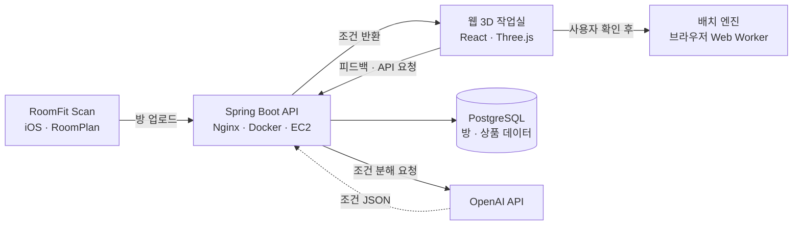

| 영역 | 기술 |
|:---|:---|
| **App** | Swift, SwiftUI, RoomPlan |
| **Web** | React 19, TypeScript, Vite, Three.js (React Three Fiber), Tailwind CSS, Web Worker |
| **Backend** | Java 21, Spring Boot 3.5, Spring Data JPA, PostgreSQL, OpenAI API |
| **Infra** | AWS EC2, Docker, Nginx, GHCR, GitHub Actions |

## Repository

RoomFit 모노레포입니다. 각 폴더의 커밋 히스토리는 이전 레포에서 그대로 옮겨졌습니다 (`git log -- backend/`).

| 폴더 | 내용 | 이전 레포 |
|:---|:---|:---|
| [`app/`](app/) | iOS (Swift, RoomPlan) 앱 | dav3park/RoomFit-App |
| [`web/`](web/) | React + Vite 웹 클라이언트 | dav3park/RoomFit-Web |
| [`backend/`](backend/) | Spring Boot (Java 21) API 서버 | dav3park/RoomFit-Backend |

### CI/CD

- `.github/workflows/backend-ci.yml` — `backend/**` 변경 시 테스트 → GHCR 이미지 → EC2 배포
- `.github/workflows/web-deploy.yml` — `web/**` 변경 시 빌드 → EC2 배포

## Team 파라파라 · 경희대학교

| 이름 | 역할 |
|:---|:---|
| 박찬종 | 팀장 |
| 김병규 | 팀원 |
